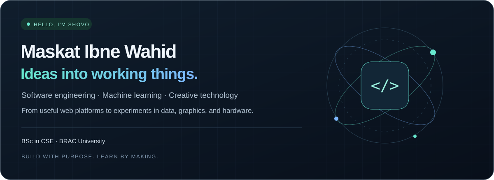
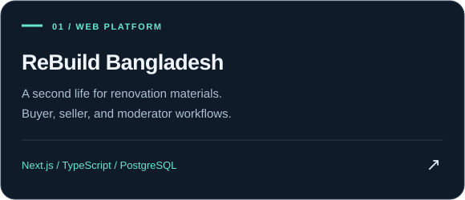
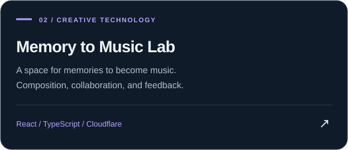
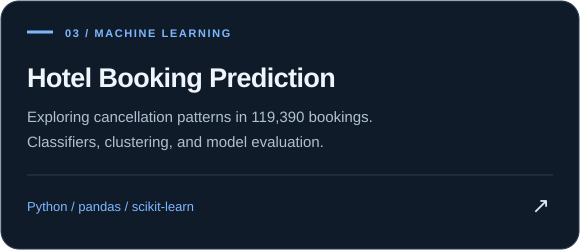
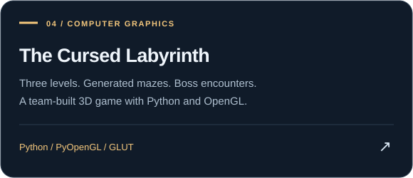
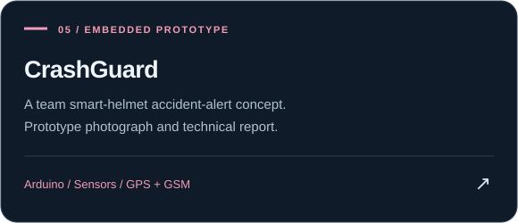
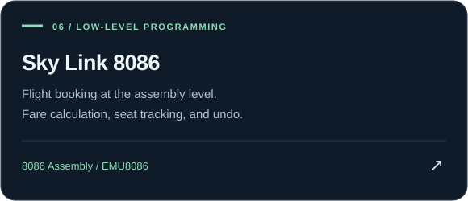

 

**Curious about the whole system. Focused on making it work.**

### A little about me

I'm **Maskat Ibne Wahid Shovo**, a Computer Science and Engineering graduate from **BRAC University**. I enjoy connecting ideas to working software: useful web applications, experiments with data, interactive graphics, and hardware prototypes.

- **Building:** web platforms with clear workflows, thoughtful interfaces, and documented behavior.
- **Exploring:** machine learning, computer vision, and the intersection of technology and creativity.
- **Learning through:** individual projects, team engineering work, and technical writing.

---

### Selected work

A few projects that show how I think, build, and experiment. Click a card to explore the source and documentation.

<table>
<tr>
<td width="50%"></td>
<td width="50%"></td>
</tr>
<tr>
<td></td>
<td></td>
</tr>
<tr>
<td></td>
<td></td>
</tr>
</table>

Academic team projects retain their contributor credits and scope in their repositories. Prototype and experiment results are described with their limitations.

---

### Tools I work with

**Languages & web**

**Data & experimentation**

**Building & verification**

---

**Good projects tell a story. The code shows the work.**

Thanks for stopping by — explore a repository, read the decisions, and see what's taking shape.

